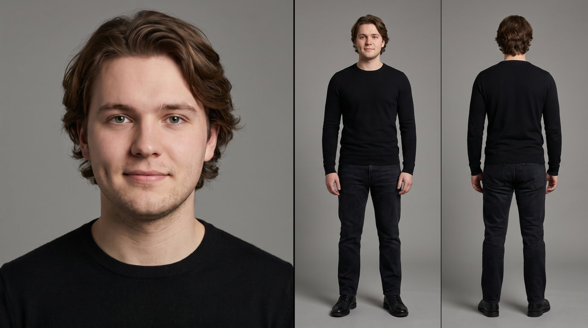
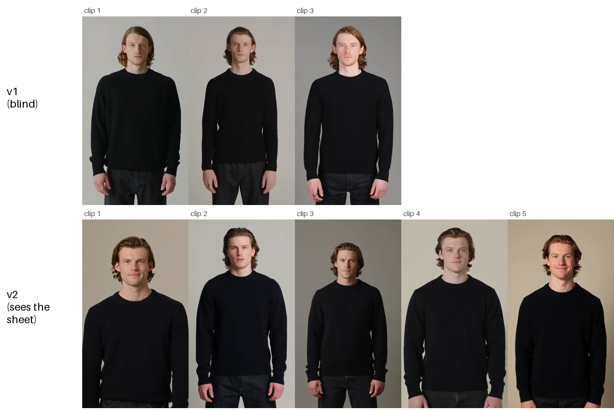
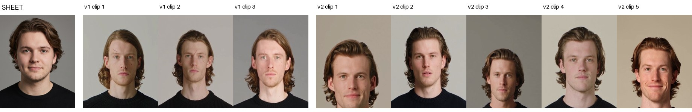
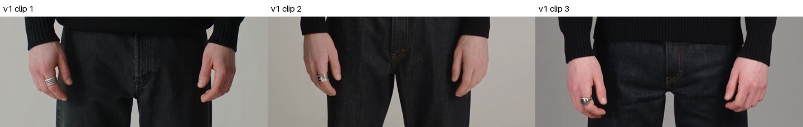

# Repairer v1 vs v2: what changed, how it was tested, what the videos show

**Date:** 7 October 2026 · **Learning outcomes:** 7 Realising, 2 Analysing
**Related:** `docs/repairer-cannot-see.md` (16 Sept) found the v1 defect. This document tests the fix.

---

## 1. Question and criteria

**Question:** when the repaired descriptions are rendered to video, does v2 produce a person closer
to the avatar than v1?

The rubric cannot answer this. Both versions pass it. It checks that a hair length is *there*, not
that it is *true*.

| Criterion | Set | Measured by |
|---|---|---|
| **A. No invented details** | 16 Sept (decision log), before any video | Each added detail checked against the sheet, then looked for in the video |
| **B. Similar to the avatar** | 7 Oct, before the v1 videos | Video frames next to the sheet |
| **C. Consistent across renders** | 7 Oct, before the v1 videos | Repeated renders side by side |

B and C came from my own first viewing of the v2 videos, so I already believed them when I set them.

---

## 2. What changed between v1 and v2

Same function (`repairSpans`), same model (`claude-opus-5`), same failing fragments, same rubric.
Two differences: **what the model gets** and **what it is told**.

### 2.1 What it gets

`apps/backend/src/agents/repairer/run.ts`:

```ts
const promptVersion: RepairerPromptVersion = sheet ? "v2" : "v1";

const { parsed_output } = await deps.transport({
  system: sheet
    ? buildRepairerSystemPromptV2(checks, statedFacts) // v2
    : buildRepairerSystemPrompt(checks),                // v1
  user,                                                 // only the failing fragments
  schema: RepairerOutputSchema,
  ...(sheet ? { image: sheet } : {}),                   // v2: the picture goes with them
});
```

| | v1 | v2 |
|---|---|---|
| Failing fragments + failed checks | ✅ | ✅ |
| Avatar picture | ❌ | ✅ |
| Avatar brief (e.g. "about 1.78m") | ❌ | ✅ |

The picture and brief are loaded by `apps/backend/src/avatar/grounding.ts`:

```ts
export async function loadGrounding(store, avatarId): Promise<RepairGrounding | null> {
  const sheet = await store.readImage(avatarId);
  if (!sheet || !isSupportedMediaType(sheet.mediaType)) return null;
  const record = await store.get(avatarId);
  return {
    sheet: { imageBase64: sheet.bytes.toString("base64"), mediaType: sheet.mediaType },
    statedFacts: record ? statedFactsFor(record) : null,
  };
}
```

### 2.2 What it is told

v1, `prompt.ts`. Asks for observable facts with nothing to observe:

```text
3. Replace with observable facts a video model can draw: countable features, named colours,
   named garments. No mood words, no feelings, no camera or lighting instructions.
```

v2, `prompt-v2.ts`. Keeps v1's five rules and adds four:

```text
3. Every fact in a replacement must be VISIBLE IN THE SHEET. Describe what you can see there and
   nothing else.
6. Where the sheet does not show a detail, LEAVE IT OUT and accept that the check may score low.
   Withholding a detail you can plainly see is as wrong as inventing one you cannot.
7. Height may be stated ONLY if the stated facts give it. Copy the figure; never estimate a number
   from the picture. Otherwise write a proportion you can see.
9. In `rationale`, say where each fact came from: the sheet, or the stated facts.
```

Plus one line sent with the image:

```ts
export const REPAIRER_V2_SHEET_USER_NOTE =
  "The image above is the character reference sheet for this person. Every replacement you write must describe what is in it.";
```

---

## 3. Method

| Kept the same | |
|---|---|
| Avatar | `eaa18108-4b38-408f-b683-2fc897ce2537` |
| Starting description | Identical for both runs |
| Rubric | `v1.json`, 9 checks |
| Agent model | `claude-opus-5` |
| Video model | Seedance 2.5 via OpenRouter |
| Clip settings | 4 s, 480x854 (cheapest available) |
| Shot prompt | `video/shotPrompt/v1.ts`, only the description inside it changes |

| | Run | Videos | Rendered | Cost |
|---|---|---|---|---|
| v1 | `bee3bcd6` | 3 | 7 Oct | $0.42 each |
| v2 | `01f0c6f3` | 5 | 18 Sept | $0.42 each |

```bash
RUN_LIVE_API=1 npm run compare -- \
  --avatar eaa18108-4b38-408f-b683-2fc897ce2537 \
  --run <runId> --seconds 4 --size 480x854
```

Frames taken at 2.0 s with `ffmpeg`, placed next to the sheet, read by me and by Claude's vision.
Not blind.


*The avatar: medium-length wavy brown hair over the ears, round face, light stubble, average build,
black crewneck, dark jeans, black shoes.*

---

## 4. Results: the text

### 4.1 Scores

| Check | v1 pass 1 | v1 final | v2 pass 1 | v2 final |
|---|---|---|---|---|
| `age_build` | 3 | 5 | 3 | 5 |
| `face_skin` | 4 | 5 | 4 | 5 |
| `hair_spec` | 3 | 5 | 3 | 5 |
| `wardrobe` | 4 | 4 | 4 | 4 |
| `anchor_marker` | 1 | **5** | 3 | **4** |
| safety + drawable (4 checks) | pass | pass | pass | pass |

v1 scores higher on `anchor_marker` because it invented two marks. v2 refused to. Predicted on
16 Sept: honesty should cost a band only on `anchor_marker`.

### 4.2 Final descriptions

**v1:**
> A young man in his mid-twenties with chestnut-brown wavy hair, **shoulder-length** and parted on
> the left, tucked behind the ears, green eyes, light stubble and fair skin, **a small dark mole
> below his left eye and a thin pale scar crossing his right eyebrow**, of **lean, narrow-shouldered
> build with slim arms and about 5 foot 8**, with long legs relative to the torso, wearing a black
> crewneck sweater, dark jeans, black leather shoes and **a flat silver ring on his right index
> finger**.

**v2:**
> A young man in his mid-twenties with **medium-length wavy brown hair in a side part, swept back off
> the forehead and falling over the ears**, green eyes, **a dimple in the left cheek and a faint
> stubble shadow along the jawline and above the upper lip** and fair skin, of a man in his early
> twenties, 1.78m tall, of **average build on a medium frame** with shoulders and hips close to the
> same width and legs roughly even in length with the torso, about 1.78m tall, with even shoulders
> and straight posture, wearing a black crewneck sweater, dark jeans and black leather shoes.

### 4.3 Checked against the sheet (criterion A)

| Detail | v1 | True? | v2 | True? |
|---|---|---|---|---|
| Hair length | shoulder-length | ❌ | medium, over the ears | ✅ |
| Height | about 5 ft 8 | ❌ brief says 1.78m | 1.78m | ✅ copied from brief |
| Build | lean, narrow-shouldered | ❌ | average, medium frame | ✅ |
| Mole under left eye | added | ❌ | — | |
| Scar across eyebrow | added | ❌ | — | |
| Silver ring | added | ❌ | — | |
| Dimple, left cheek | — | | added | ✅ brief + close-up |

**v1: 6 invented details. v2: 0.**

v2 records where each fact came from (rule 9):

> `age_build` → "average build on a medium frame, about 1.78m tall, with even shoulders and straight
> posture". *Why:* "the 1.78m figure is copied from the stated facts; even shoulders and upright
> stance are visible in the front and back full-length views."

v1 has no such field.

**v2 defect:** its final text repeats the height and says both "mid-twenties" and "early twenties".
Two fragment repairs were spliced without seeing each other. Open (section 8).

---

## 5. Results: the videos


*Top: 3 v1 videos. Bottom: 5 v2 videos. Frame at 2.0 s.*


*Faces, avatar on the left. Scar and mole on every v1 face.*


*Right hand, every v1 video. The ring is on all three.*

> **[Screenshot: Compare screen gallery showing the 3 v1 and 5 v2 clips]**

### 5.1 Criterion A: do invented details appear?

**Yes, all of them, in all 3 v1 videos:** scar, mole, ring. The video model draws whatever the text
says. A description that passes the rubric with invented details gives a person with invented
details, and the score gives no warning. No v2 video shows any of them.

### 5.2 Criterion B: similar to the avatar

| | Avatar | v1 | v2 |
|---|---|---|---|
| Hair | medium, over the ears | ❌ long, past the jaw | ✅ medium, over the ears |
| Build | average | ❌ thin | ✅ average |
| Sweater | black crewneck | ✅ | ✅ |
| Invented marks | none | ❌ scar, mole, ring | ✅ none |
| Face | round, full cheeks | ❌ long, gaunt | ❌ different face |

### 5.3 Criterion C: consistency

| | Same person every render? |
|---|---|
| v1 | Yes: same long hair, thin build, scar, mole, ring. **The wrong person, every time.** |
| v2 | Yes, mostly: same hair, build, clothes. Faces vary; one has redder hair. |

Consistency does not separate them. Criterion B does.

### 5.4 My conclusion, checked

My reading: v2 videos are (1) more consistent and (2) more like the avatar.

- **(2) holds:** hair, build, no invented marks. Not the face.
- **(1) does not separate v1 and v2:** both are consistent; v1 is consistently wrong.

### 5.5 The face

No video matches the avatar's face. Seedance gets text only (it refuses a real-looking face as an
input image), and text does not pin down a face. Not a Repairer problem.

---

## 6. What went wrong

**Compared the wrong videos.** On 18 Sept I made 5 video pairs and read them as v1 vs v2. Each pair
was actually *unrepaired* vs v2; no v1 video existed. The app labelled the unrepaired clip "repairer
v2", which made it easy to miss. Found on 7 Oct while writing this. Fixes: rendered 3 real v1
videos ($2.52), removed the unrepaired clips from the Compare screen, and changed the labels:

```ts
// apps/frontend/src/domain/labels.ts
export function clipRepairLabel(side: "before" | "after", version: string | null): string {
  if (side === "before") return "no repair";
  return version ? `repairer ${version}` : "repairer v1 (inferred, not recorded)";
}
```

**The paste box bypassed v2.** v2 only runs with a picture. A "Paste a description" box started runs
with none, and the server silently fell back to v1. Since 5 Oct (`eee31df`, `3c7aa87`) every run
needs an avatar:

```ts
// apps/backend/src/server/routes/runs.ts
const grounding = deps.avatars ? await loadGrounding(deps.avatars, avatarId) : null;
if (!grounding) {
  return reply.code(422).send({
    error: `avatar "${avatarId}" has no character sheet the Repairer can see`,
  });
}
```

---

## 7. Limits

- One avatar.
- 3 v1 and 5 v2 videos: enough for 3/3 invented marks, not for a similarity score.
- Not blind; I already believed v2 was better.
- No face-similarity metric; "similar" is judged on hair, build, clothes, marks.
- v1 rendered 7 Oct, v2 18 Sept; same model id and settings.
- One run per version.

## 8. Next steps

1. Fix v2's repeated-height splice bug.
2. More avatars, including an uploaded one with no brief (rule 7 proportions).
3. Blind check: someone matches unlabelled frames to the avatar.
4. The face: needs a better face description or a video route that takes a reference image.

---

*Made with Claude Code (Claude Opus 5.5) at my direction. Frames read by me and by Claude's vision.
Videos paid on my OpenRouter account. Data: `data/runs/`, `data/comparisons/`.*
